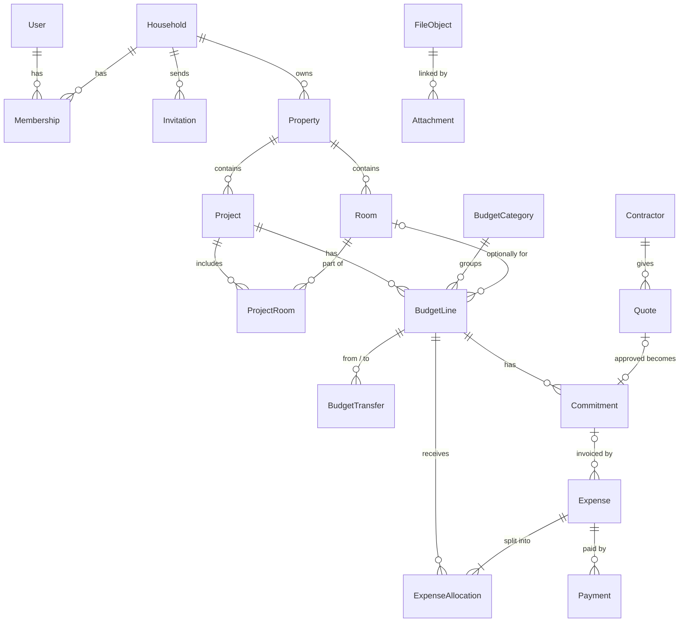

# Initial Data Model

**Status:** first draft from Milestone 0. The real `prisma/schema.prisma` gets built a piece at a time, starting in Milestone 2, and this document is updated each time.

This describes **what** we store and how records connect. Column types and indexes are finalized when each milestone is built.

## Ground rules

1. **Every household-owned table has a `householdId` column**, which is indexed and required. All queries go through the data layer, which always filters by it (ADR-007).
2. **IDs** are random strings (`cuid2`), never counting numbers like 1, 2, 3, so nobody can guess another record's ID.
3. **Money** is stored as `BigInt` cents in columns ending in `Cents`. Currency is stored on the household (ADR-008).
4. **Measurements** are stored in millimetres as integers (`lengthMm`), whatever unit the user typed. The unit they typed is saved too, so we can show it back exactly as entered. Calculated values such as area are computed on the fly and labeled as estimates.
5. **Timestamps:** every table has `createdAt` and `updatedAt`. Most also have `createdById`.
6. **Soft delete:** important records (expenses, payments, documents, transfers) are archived (`archivedAt`) rather than deleted, so the history stays intact.
7. **No branding or domains** anywhere in the data (ADR-015).

## Overview diagram (core, MVP)

---

## 1. Identity and households (Milestone 2)

Better Auth creates and manages its own tables (`user`, `session`, `account`, `verification`, `organization`, `member`, `invitation`). We use its **organization** as our **Household**. When we need extra fields, we add them to its tables using Better Auth's schema extension, rather than keeping a second, parallel copy of the same data.

| Model | Key fields | Notes |
|---|---|---|
| **User** | id, name, email (unique), emailVerified, image, createdAt | The password hash lives in Better Auth's `account` table. |
| **Household** (organization) | id, name, slug, currency (default `USD`), measurementSystem (`imperial` \| `metric`), timezone | One for now; the design allows many. |
| **Membership** (member) | id, householdId, userId, role (`owner` \| `member` \| `viewer`) | A user can belong to several households. The pair (householdId, userId) is unique. |
| **Invitation** | id, householdId, email, role, status, expiresAt, invitedById | The token is single-use; the link is built from `APP_URL`. |
| **Session** | id, userId, expiresAt, activeHouseholdId, ipAddress, userAgent | Deleting rows logs the user out. Used for "log out of all devices". |

### Roles (first version)

| Can… | Owner | Member | Viewer |
|---|:-:|:-:|:-:|
| View projects, rooms, budget and documents | ✓ | ✓ | ✓ |
| Create and edit records | ✓ | ✓ | |
| Approve quotes, baseline budgets and transfer budget | ✓ | ✓ | |
| Invite or remove members, change roles | ✓ | | |
| Export data, change household settings | ✓ | | |

We expect Jeff and his partner to both be **Owners**.
Permissions are checked by a single `can(context, action, resource)` function, so the rules live in one place.

## 2. Properties, projects and rooms (Milestone 3)

| Model | Key fields | Notes |
|---|---|---|
| **Property** | id, householdId, name, addressLine1/2, city, region, postalCode, country, propertyType, notes | |
| **Project** | id, householdId, propertyId, name, description, status (`idea` \| `planning` \| `in_progress` \| `on_hold` \| `completed` \| `canceled`), plannedStart, plannedEnd, actualStart, actualEnd, baselinedAt | |
| **Room** | id, householdId, propertyId, name, type (`bedroom`, `bathroom`, `kitchen`, `exterior`, `whole_house`, …), description, floorLevel, lengthMm, widthMm, ceilingHeightMm, enteredUnit, existingConditions, notes | A room belongs to the **property**, not to a single project. |
| **ProjectRoom** | projectId, roomId, plannedImprovements | The many-to-many join: a room can take part in many projects over time. |
| **Opening** | id, householdId, roomId, kind (`window` \| `door` \| `other`), label, widthMm, heightMm, sillHeightMm, notes | Window and door measurements. |
| **Measurement** | id, householdId, roomId, label, valueMm, enteredUnit, notes | For extra measurements that don't fit the fixed fields. |

## 3. Budget (Milestone 4)

See `BUDGET_DEFINITIONS.md` for what each number means.

| Model | Key fields | Notes |
|---|---|---|
| **BudgetCategory** | id, householdId, name, kind (`standard` \| `contingency`), sortOrder | Starts with a default set; users can edit it. |
| **BudgetLine** | id, householdId, projectId, categoryId, roomId (nullable), name, originalCents (set when baselined), allocatedCents, estimateCents, notes | The pair (projectId, categoryId, roomId, name) is unique. |
| **BudgetAdjustment** | id, householdId, budgetLineId, amountCents (+/−), reason, effectiveDate, createdById | Changes the budget total on purpose. |
| **BudgetTransfer** | id, householdId, fromLineId, toLineId, amountCents (> 0), reason, effectiveDate, allowOverAllocation, reversesTransferId, createdById | Never edited or deleted; undone by a reversing transfer. |
| **Commitment** | id, householdId, budgetLineId, source (`quote` \| `contract` \| `change_order` \| `order` \| `manual`), sourceId, description, amountCents, committedOn | |
| **Vendor** | id, householdId, name, kind (`store` \| `online` \| `contractor` \| `other`), contractorId (nullable), website | Shops and suppliers. A contractor can also act as a vendor. |
| **Expense** | id, householdId, vendorId, commitmentId (nullable), description, expenseDate, totalCents, status (`recorded` \| `due` \| `paid` \| `partially_paid`), dueDate, refundOfExpenseId, notes | |
| **ExpenseAllocation** | id, householdId, expenseId, budgetLineId, amountCents, kind (`item` \| `tax` \| `shipping`) | The allocations must add up to `totalCents` (checked in the service and in a database check). |
| **Payment** | id, householdId, expenseId, amountCents, paidOn, method, reference, notes | |

## 4. Contractors (Milestone 5)

| Model | Key fields |
|---|---|
| **Contractor** | id, householdId, companyName, contactName, trade, phone, email, website, address, licenseNumber, licenseState, licenseExpiresOn, insuranceExpiresOn, status (`prospect` \| `active` \| `past` \| `do_not_use`), notes |
| **ContractorProject** | contractorId, projectId, role |
| **Quote** | id, householdId, contractorId, projectId, budgetLineId (nullable), title, status (`received` \| `under_review` \| `approved` \| `rejected` \| `superseded`), validUntil |
| **QuoteRevision** | id, householdId, quoteId, revisionNumber, amountCents, receivedOn, summary |
| **Contract** | id, householdId, contractorId, projectId, quoteId, valueCents, signedOn, startDate, endDate |
| **ChangeOrder** | id, householdId, contractId, description, amountCents (+/−), approvedOn |
| **Communication** | id, householdId, contractorId, projectId, channel (`call` \| `email` \| `text` \| `meeting` \| `note`), occurredAt, summary |
| **Warranty** | id, householdId, contractorId (nullable), materialId (nullable), projectId, coverage, startsOn, expiresOn |
| **Task** (simple version) | id, householdId, projectId, roomId, title, description, status, priority, assigneeUserId, assigneeContractorId, dueDate, completedAt |

Contractor payments are **Expenses linked to the contract's Commitment**, plus **Payments** against those expenses. There is no separate contractor-payment table, so there is only one place money is recorded.

## 5. Files and attachments (storage in Milestone 3, used everywhere)

| Model | Key fields | Notes |
|---|---|---|
| **FileObject** | id, householdId, storageKey (random), originalName, mimeType (detected from content), sizeBytes, sha256, uploadedById | The file itself. The storage key is never built from user input. |
| **Attachment** | id, householdId, fileId, purpose (`photo` \| `receipt` \| `quote` \| `contract` \| `manual` \| `floor_plan` \| …), caption, takenOn, phase, plus **one** nullable foreign key: propertyId / projectId / roomId / expenseId / quoteId / contractId / contractorId / taskId / materialId / warrantyId | A database check makes sure exactly one target is set. That keeps real foreign keys (so the database guarantees the record exists) without needing a separate table for every record type. |

Document versions (Milestone 8) will add a `Document` with a `DocumentVersion` table pointing to FileObjects.

## 6. Activity history (from Milestone 3 on)

| Model | Key fields |
|---|---|
| **ActivityEvent** | id, householdId, actorUserId, action (`project.created`, `budget.transferred`, …), entityType, entityId, summary, data (JSON), createdAt |

Written by the service layer whenever something important changes. It powers the activity feed and the audit history, and records are never deleted.

## 7. Later milestones (outline only)

- **Materials and orders (M6):** `Material`, `Order`, `OrderItem` (which saves `unitPriceCents` at the time of purchase), `Shipment`, `ShipmentItem`, `Return`.
- **Scheduling (M7):** `Milestone`, `TaskDependency` (with a cycle check), `CalendarEvent` (appointments, inspections and deliveries), `Reminder`.
- **Design boards (M8):** `DesignBoard`, `BoardItem` (an image, a product reference, or a color or finish), plus `isPreferred` / `isApproved` flags.
- **Notifications (M9):** `Notification` (per user and household), `NotificationPreference`.
- **AI (M11):** `AiUsage` (tokens and cost per user and household), `AiConsent`.

## Isolation tests we will write (Milestone 2 onward)

For every model, a test sets up Household A and Household B, signs in as a user from A, and confirms that reading, listing, updating, deleting and searching for B's records, **and downloading B's files**, all behave as if those records don't exist (the app answers 404 Not Found, never 403 Forbidden, so it doesn't reveal that the record exists).
