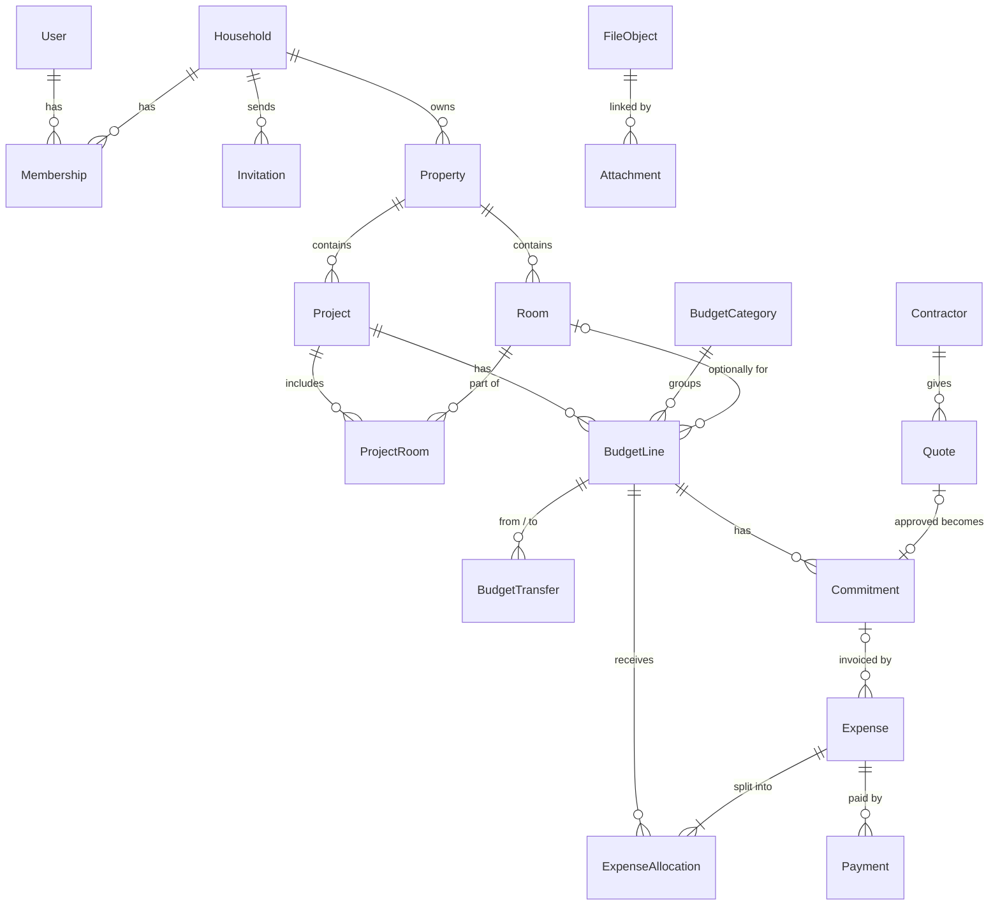

# Initial Data Model

**Status:** first draft from Milestone 0. The real `prisma/schema.prisma` gets built a piece at a time, starting in Milestone 2, and this document is updated each time.

This describes **what** we store and how records connect. Column types and indexes are finalized when each milestone is built.

## Ground rules

1. **Every household-owned table has a `workspaceId` column** (a household is stored as a general _workspace_, ADR-017), which is indexed and required. All queries go through the data layer, which always filters by it (ADR-007).
2. **IDs** are random strings, never counting numbers like 1, 2, 3, so nobody can guess another record's ID. Better Auth makes its own; our tables use a random UUID written without hyphens (`src/server/data/ids.ts`).
3. **Money** is stored as `BigInt` cents in columns ending in `Cents`. Currency is stored on the household (ADR-008).
4. **Measurements** are stored in millimetres as integers (`lengthMm`), whatever unit the user typed. The unit they typed is saved too, so we can show it back exactly as entered. Calculated values such as area are computed on the fly and labeled as estimates.
5. **Timestamps:** every table has `createdAt` and `updatedAt`. Most also have `createdById`.
6. **Soft delete:** important records (expenses, payments, documents, transfers) are archived (`archivedAt`) rather than deleted, so the history stays intact.
7. **No branding or domains** anywhere in the data (ADR-015).

## Overview diagram (core, MVP)

---

## 1. Identity and households (Milestone 2)

**Built in Milestone 2:** `users`, `sessions`, `accounts` and `verifications` (step 1), then `workspaces`, `memberships` and `invitations` (step 2). Tables are plural and snake_case in PostgreSQL; Prisma maps them to Better Auth's names (its _organization_ is our `Workspace`, its _member_ is our `Membership`, and its `organizationId` is our `workspaceId`). A database check allows only the roles `owner`, `member` and `viewer`.

Better Auth creates and manages its own tables (`user`, `session`, `account`, `verification`, `organization`, `member`, `invitation`). We use its **organization** as our **Household**. When we need extra fields, we add them to its tables using Better Auth's schema extension, rather than keeping a second, parallel copy of the same data.

| Model                                               | Key fields                                                                                                                                  | Notes                                                                                                                           |
| --------------------------------------------------- | ------------------------------------------------------------------------------------------------------------------------------------------- | ------------------------------------------------------------------------------------------------------------------------------- |
| **User**                                            | id, name, email (unique), emailVerified, image, createdAt                                                                                   | The password hash lives in Better Auth's `account` table.                                                                       |
| **Household** (organization, stored as `Workspace`) | id, name, slug, kind (`household`; later perhaps `company`), currency (default `USD`), measurementSystem (`imperial` \| `metric`), timezone | currency, measurementSystem and timezone are added when first needed (Milestones 3 and 4). One for now; the design allows many. |
| **Membership** (member)                             | id, workspaceId, userId, role (`owner` \| `member` \| `viewer`)                                                                             | A user can belong to several households. The pair (workspaceId, userId) is unique.                                              |
| **Invitation**                                      | id, workspaceId, email, role, status, expiresAt, invitedById                                                                                | The token is single-use; the link is built from `APP_URL`.                                                                      |
| **Session**                                         | id, userId, expiresAt, activeHouseholdId, ipAddress, userAgent                                                                              | Deleting rows logs the user out. Used for "log out of all devices".                                                             |

### Roles (first version)

| Can…                                                 | Owner | Member | Viewer |
| ---------------------------------------------------- | :---: | :----: | :----: |
| View projects, rooms, budget and documents           |   ✓   |   ✓    |   ✓    |
| Create and edit records                              |   ✓   |   ✓    |        |
| Approve quotes, baseline budgets and transfer budget |   ✓   |   ✓    |        |
| Invite or remove members, change roles               |   ✓   |        |        |
| Export data, change household settings               |   ✓   |        |        |

We expect Jeff and his partner to both be **Owners**.
Permissions are checked by a single `can(context, action, resource)` function, so the rules live in one place.

## 2. Properties, projects and rooms (Milestone 3)

Built in Milestone 3, with a few differences from the plan below: `propertyType`, `existingConditions`, `baselinedAt` and the extra **Measurement** table are left for later milestones, when something uses them. Openings also store the unit they were typed in. The household's choice of feet and inches or metric is `workspaces.measurement_system`.

**Same-household links are enforced by the database.** Every table has a unique `(id, workspace_id)` pair, and links point at that pair (for example a project's `(property_id, workspace_id)`). So even if the code forgot a check, the database would refuse to put a project under another household's property, or link another household's room to a project.

| Model           | Key fields                                                                                                                                                                                                    | Notes                                                                   |
| --------------- | ------------------------------------------------------------------------------------------------------------------------------------------------------------------------------------------------------------- | ----------------------------------------------------------------------- |
| **Property**    | id, workspaceId, name, addressLine1/2, city, region, postalCode, country, propertyType, notes                                                                                                                 |                                                                         |
| **Project**     | id, workspaceId, propertyId, name, description, status (`idea` \| `planning` \| `in_progress` \| `on_hold` \| `completed` \| `canceled`), plannedStart, plannedEnd, actualStart, actualEnd, baselinedAt       |                                                                         |
| **Room**        | id, workspaceId, propertyId, name, type (`bedroom`, `bathroom`, `kitchen`, `exterior`, `whole_house`, …), description, floorLevel, lengthMm, widthMm, ceilingHeightMm, enteredUnit, existingConditions, notes | A room belongs to the **property**, not to a single project.            |
| **ProjectRoom** | projectId, roomId, plannedImprovements                                                                                                                                                                        | The many-to-many join: a room can take part in many projects over time. |
| **Opening**     | id, workspaceId, roomId, kind (`window` \| `door` \| `other`), label, widthMm, heightMm, sillHeightMm, notes                                                                                                  | Window and door measurements.                                           |
| **Measurement** | id, workspaceId, roomId, label, valueMm, enteredUnit, notes                                                                                                                                                   | For extra measurements that don't fit the fixed fields.                 |

## 3. Budget (Milestone 4)

See `BUDGET_DEFINITIONS.md` for what each number means. Every amount is whole cents in a `BIGINT` column. Nothing calculated (forecast, available, variance, paid status) is stored.

| Model                 | Key fields                                                                                                                                                     | Notes                                                                                                                     |
| --------------------- | -------------------------------------------------------------------------------------------------------------------------------------------------------------- | ------------------------------------------------------------------------------------------------------------------------- |
| **BudgetCategory**    | id, workspaceId, name, kind (`standard` \| `contingency`), sortOrder                                                                                           | A starting set is created the first time a household opens the budget; more can be added.                                 |
| **Project** (added)   | budgetLockedAt, budgetLockedById                                                                                                                               | When the original budget was locked in.                                                                                   |
| **BudgetLine**        | id, workspaceId, projectId, categoryId, roomId (nullable), name (label, may be empty), plannedCents, originalCents (set at lock-in), estimateCents, notes      | Unique per (project, category, room, name), with "no room" counting as one value (`NULLS NOT DISTINCT`).                  |
| **BudgetAdjustment**  | id, workspaceId, lineId, amountCents (+/−, never 0), reason, effectiveDate, createdById                                                                        | Permanent: a database trigger refuses updates and deletes.                                                                |
| **BudgetTransfer**    | id, workspaceId, fromLineId, toLineId, amountCents (> 0), reason, effectiveDate, allowOverAllocation, reversesTransferId (unique), createdById                 | Permanent, like adjustments. Undone by a reversing transfer, once.                                                        |
| **Vendor**            | id, workspaceId, name (unique per household), kind, website, notes                                                                                             | Created from the name typed on an expense or commitment. Contractors (Milestone 5) will link here.                        |
| **Commitment**        | id, workspaceId, lineId, vendorId, source (`quote` \| `contract` \| `change_order` \| `order` \| `manual`), description, amountCents (≠ 0), committedOn, notes | A change order can be negative.                                                                                           |
| **Expense**           | id, workspaceId, vendorId, commitmentId, refundOfExpenseId, description, expenseDate, dueDate, totalCents, notes                                               | Positive, or negative for a refund (which must point at the original). Receipts are attachments with purpose `receipt`.   |
| **ExpenseAllocation** | id, workspaceId, expenseId, lineId, amountCents, kind (`item` \| `tax` \| `shipping`), position                                                                | Must add up to the expense total: checked by the service and by a deferred database trigger when the transaction commits. |
| **Payment**           | id, workspaceId, expenseId, amountCents, paidOn, method, reference, notes                                                                                      | Same sign as the expense; can't add up to more than it.                                                                   |

Every link uses the composite `(id, workspace_id)` keys, so the database refuses anything that crosses households. A project with money recorded in its budget, and a room used by a budget line, can't be deleted.

### Room estimates (Milestone 5, part 3)

| Model                | Key fields                                                                                                                                                                                                                                               | Notes                                                                                                                                                                                                 |
| -------------------- | -------------------------------------------------------------------------------------------------------------------------------------------------------------------------------------------------------------------------------------------------------- | ----------------------------------------------------------------------------------------------------------------------------------------------------------------------------------------------------- |
| **PriceItem**        | id, workspaceId, name (unique per household), measure (`floor` \| `walls` \| `ceiling` \| `perimeter`), unit (`sq_ft` \| `sq_m` \| `lin_ft` \| `lin_m` \| `gallon` \| `litre`), priceCents, coverageMm2, coats, laborCents, wastePercent, taxable, notes | The household's price list. Checks: lengths are priced per foot or metre, areas per sq ft, m² or can; a can needs its coverage; waste 0–100%, coats 1–10. Can't be deleted while an estimate uses it. |
| **RoomEstimate**     | id, workspaceId, projectId, priceItemId, name (unique per project), materialCategoryId, laborCategoryId (nullable), lineMode (`per_room` \| `one_line`), notes                                                                                           | Goes with its project.                                                                                                                                                                                |
| **RoomEstimateArea** | id, workspaceId, estimateId, roomId (nullable), label, typedAmount (mm², or mm for a perimeter), enteredUnit                                                                                                                                             | A room measured from its size, the same room with a size typed in, or a labelled area of its own (room null, label and size required). A room is in an estimate once.                                 |

`Workspace.materialsTaxBp` holds the sales tax on materials in hundredths of a percent (925 = 9.25%, at most 50%). `BudgetLine.estimateSourceId` marks the lines an estimate keeps up to date, and `Quote.estimateId` the estimate a quote is compared with. Both are `NO ACTION` links that the service clears before deleting an estimate, so a project's cascade can still remove everything at once.

## 4. Contractors (Milestone 5)

Built in parts. **Part 1** (directory, log, warranties, tasks) and **part 2** (quotes, contracts, change orders, contractor payments) are in the database. **Part 3** (room-based cost calculator for flooring, paint and trim, a price list, sales tax) follows.

| Model                     | Key fields                                                                                                                                                                                                                                     | Notes                                                                                                                                                                                                                                                                                                                                                                      |
| ------------------------- | ---------------------------------------------------------------------------------------------------------------------------------------------------------------------------------------------------------------------------------------------- | -------------------------------------------------------------------------------------------------------------------------------------------------------------------------------------------------------------------------------------------------------------------------------------------------------------------------------------------------------------------------- |
| **Contractor**            | id, workspaceId, vendorId (unique), contactName, trade, phone, email, website, address, licenseNumber, licenseState, licenseExpiresOn, insuranceProvider, insuranceExpiresOn, status (`prospect` \| `active` \| `past` \| `do_not_use`), notes | The name lives on the **Vendor**: a contractor _is_ a shop or supplier with more details, so bills already recorded under that name show on the contractor's page (ADR-024).                                                                                                                                                                                               |
| **ContractorProject**     | contractorId, projectId, role                                                                                                                                                                                                                  | Who works on which project.                                                                                                                                                                                                                                                                                                                                                |
| **Communication**         | id, workspaceId, contractorId, projectId (nullable), channel (`call` \| `email` \| `text` \| `meeting` \| `note`), occurredOn, summary                                                                                                         | Typed in by hand.                                                                                                                                                                                                                                                                                                                                                          |
| **Warranty**              | id, workspaceId, contractorId, projectId, roomId (each nullable, at least one set), coverage, provider, startsOn, expiresOn, notes                                                                                                             | Documents are attachments. A material link arrives in Milestone 6.                                                                                                                                                                                                                                                                                                         |
| **Task** (simple version) | id, workspaceId, projectId, roomId (at least one), title, description, status (`todo` \| `doing` \| `done`), priority, assigneeUserId **or** assigneeContractorId, dueDate, completedAt                                                        | The assignee must be in the household.                                                                                                                                                                                                                                                                                                                                     |
| **Quote**                 | id, workspaceId, contractorId, projectId, lineId (set while approved), title, status (`received` \| `under_review` \| `approved` \| `rejected`), validUntil, notes, commitmentId (unique), decidedAt, decidedById, decisionNote                | Approving creates the budget commitment (source `quote`) at the latest revision's price. A database check keeps `approved` and `commitment_id` together. Taking the approval back deletes the commitment again (only while no contract or bills use it).                                                                                                                   |
| **QuoteRevision**         | id, workspaceId, quoteId, revisionNumber (unique per quote, from 1), amountCents (> 0), receivedOn, summary, createdById                                                                                                                       | Every price the contractor gave. The newest one is the quote's price. Only open quotes can be revised.                                                                                                                                                                                                                                                                     |
| **Contract**              | id, workspaceId, contractorId, projectId, quoteId (unique, nullable), commitmentId (unique), title, signedOn, startDate, endDate, notes                                                                                                        | Its value is its commitment's amount. From a quote, it **takes over the quote's commitment** (source becomes `contract`), so the money is never counted twice; deleting the contract hands the commitment back to the quote at the quote's price. Change orders are commitments with `source = change_order` and `contractId` set (a database check keeps those together). |

Contractor payments are **Expenses linked to the contract's Commitment** (or to a change order's, or to an approved quote's before a contract exists), plus **Payments** against those expenses. An expense has an optional **stage** (`deposit` \| `progress` \| `final`). There is no separate contractor-payment table, so there is only one place money is recorded. Quotes and contracts have their own documents (attachments with `quote_id` / `contract_id`).

Optional links between these records (a warranty's project, a task's assignee) are `ON DELETE RESTRICT` in the database, because with the household in every foreign key, Postgres would otherwise try to clear `workspace_id` too. The services let go of the link themselves when the other record is deleted: a warranty or task left with no link at all is deleted with it.

## 4b. Materials (Milestone 6)

Built in parts. **Part 1** (materials) is in the database; orders, deliveries and returns follow.

| Model        | Key fields                                                                                                                                                                                                                 | Notes                                                                                                                                                                                                                                                            |
| ------------ | -------------------------------------------------------------------------------------------------------------------------------------------------------------------------------------------------------------------------- | ---------------------------------------------------------------------------------------------------------------------------------------------------------------------------------------------------------------------------------------------------------------- |
| **Material** | id, workspaceId, projectId, roomId, supplierId (a **Vendor**; each nullable), name, category, brand, modelNumber, sku, colorFinish, productUrl, quantityMilli, unit, unitPriceCents, status, statusChangedAt, specs, notes | `status` is `considering` \| `selected` \| `ordered` \| `delivered` \| `installed` \| `returned` \| `canceled`. The quantity is in thousandths (2.5 boxes = 2500, more than zero). The price is only the **expected** one; what was paid will live on the order. |

Photos, manuals and spec sheets are attachments with `material_id` (purpose `document`: a photo or a PDF). A warranty can point to a material (`Warranty.materialId`), and a warranty on a material alone is allowed. When a project or room is deleted its materials stay and lose the link; when a material is deleted its warranties lose it (a warranty left with no link at all goes too).

## 5. Files and attachments (storage in Milestone 3, used everywhere)

| Model          | Key fields                                                                                                                                                                                                                                                                                                                      | Notes                                                                                                                                                                                      |
| -------------- | ------------------------------------------------------------------------------------------------------------------------------------------------------------------------------------------------------------------------------------------------------------------------------------------------------------------------------- | ------------------------------------------------------------------------------------------------------------------------------------------------------------------------------------------ |
| **FileObject** | id, workspaceId, storageKey (random), originalName, mimeType (detected from content), sizeBytes, sha256, uploadedById                                                                                                                                                                                                           | The file itself. The storage key is never built from user input.                                                                                                                           |
| **Attachment** | id, workspaceId, fileId, purpose (`photo` \| `receipt` \| `quote` \| `contract` \| `manual` \| `floor_plan` \| …), caption, takenOn, phase, plus **one** nullable foreign key: propertyId / projectId / roomId / expenseId / contractorId / warrantyId / quoteId / contractId / contractorId / taskId / materialId / warrantyId | A database check makes sure exactly one target is set. That keeps real foreign keys (so the database guarantees the record exists) without needing a separate table for every record type. |

Built so far: purposes `photo` (property, project, room) and `receipt` (expense; a photo or a PDF, which is only ever sent as a download). The other targets arrive with their milestones. The bytes live in the storage folder under `<workspaceId>/<random 64-character hex>`; the database never holds file contents.

Document versions (Milestone 8) will add a `Document` with a `DocumentVersion` table pointing to FileObjects.

## 6. Activity history (from Milestone 3 on)

| Model             | Key fields                                                                                                                                              |
| ----------------- | ------------------------------------------------------------------------------------------------------------------------------------------------------- |
| **ActivityEvent** | id, workspaceId, actorUserId, action (`project.created`, `budget.transferred`, …), entityType, entityId, summary, data (JSON, not built yet), createdAt |

Written by the service layer whenever something important changes. It powers the activity feed and the audit history, and records are never deleted.

## 7. Later milestones (outline only)

- **Orders (M6, parts 2 and 3):** `Order`, `OrderItem` (which saves `unitPriceCents` at the time of purchase), `Shipment`, `ShipmentItem`, `Return`.
- **Scheduling (M7):** `Milestone`, `TaskDependency` (with a cycle check), `CalendarEvent` (appointments, inspections and deliveries), `Reminder`.
- **Design boards (M8):** `DesignBoard`, `BoardItem` (an image, a product reference, or a color or finish), plus `isPreferred` / `isApproved` flags.
- **Notifications (M9):** `Notification` (per user and household), `NotificationPreference`.
- **AI (M11):** `AiUsage` (tokens and cost per user and household), `AiConsent`.

## Isolation tests we will write (Milestone 2 onward)

For every model, a test sets up Household A and Household B, signs in as a user from A, and confirms that reading, listing, updating, deleting and searching for B's records, **and downloading B's files**, all behave as if those records don't exist (the app answers 404 Not Found, never 403 Forbidden, so it doesn't reveal that the record exists).
